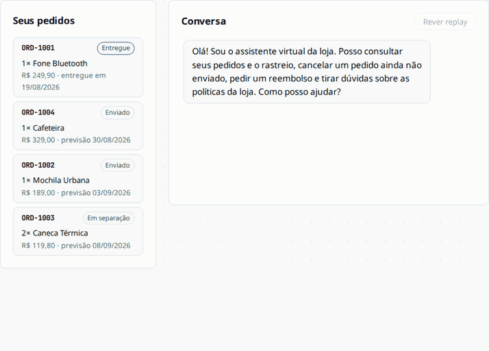
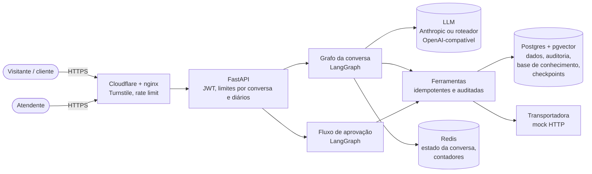
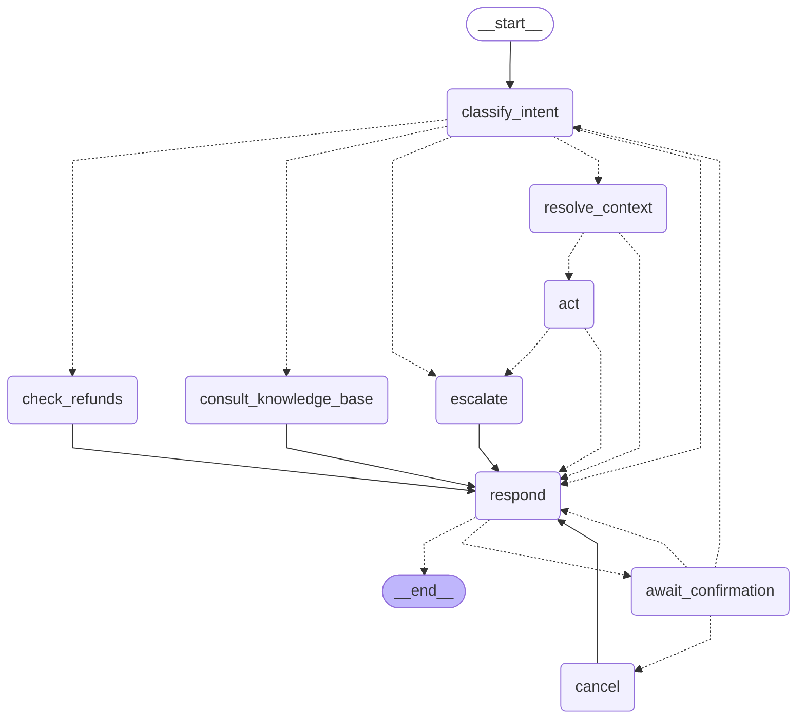
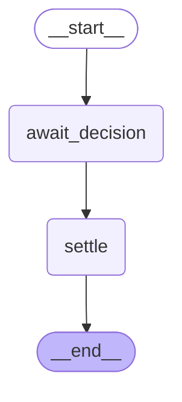

# Agente de Atendimento ao Cliente

[English summary](README.en.md) · **[Testar a demo →](https://matheusramos.dev/projects/support/)**

Um agente de IA que atende, em português, os clientes de uma loja fictícia: consulta pedidos e rastreio, cancela pedidos ainda não enviados, pede reembolsos que passam por aprovação humana e responde sobre as políticas da loja. Quando não consegue resolver, abre um chamado para um atendente.



## O problema

Atendimento de e-commerce é repetitivo ("cadê meu pedido?", "quero cancelar", "quero meu dinheiro de volta"), mas não dá para entregar a um LLM: ele inventa prazos e valores, e qualquer ação que mexe com dinheiro precisa ser auditável e, às vezes, aprovada por uma pessoa. Este projeto mostra um agente em que **o LLM só entende a mensagem e redige a resposta**: todo fato vem de uma ferramenta, toda ação é uma chamada de ferramenta idempotente e auditada, e um reembolso que exige aprovação pausa até um atendente decidir, sem travar a conversa.

Na demo, cada visitante vira um cliente fictício com pedidos em estados diferentes e, num painel ao lado, o atendente desse cliente: pede um reembolso no chat, aprova ou rejeita no painel e vê a conversa reagir.

## Arquitetura



- **API** (FastAPI): `/chat` para o cliente, `/approvals` e `/tickets` para o atendente, `/demo/visitors` para admitir um visitante após o Turnstile. Documentação interativa em [`/docs`](https://matheusramos.dev/projects/support/docs).
- **Grafo da conversa**: uma execução por mensagem do cliente. O LLM classifica a intenção e escreve a resposta a partir dos fatos das ferramentas; nada além disso.
- **Fluxo de aprovação**: um reembolso que precisa de atendente pausa numa thread própria, persistida no Postgres, e o cliente continua conversando. A decisão aparece na conversa.
- **Postgres** guarda os dados, o log de auditoria (append-only, garantido por trigger), os embeddings das políticas (pgvector, modelo multilíngue local) e os checkpoints do LangGraph. **Redis** é só cache descartável e contadores.

### Grafo da conversa

Gerado a partir do grafo compilado (arestas tracejadas são decisões de roteamento); um teste falha se o diagrama ficar desatualizado.

<!-- graph:conversation -->

<!-- /graph:conversation -->

| Nó | Faz |
|---|---|
| `classify_intent` | Classifica a mensagem em intenções e entidades; enfileira intenções extras e pede esclarecimento quando não tem certeza. |
| `resolve_context` | Escolhe o pedido: o citado, o que está em foco ou o único recente; senão lista os recentes. |
| `act` | Chama a ferramenta da intenção (status do pedido, prévia de cancelamento, pedido de reembolso); falhas repetidas da transportadora escalam. |
| `consult_knowledge_base` | Busca as seções de política relevantes (RAG). |
| `check_refunds` | Consulta o status de reembolsos já pedidos. |
| `respond` | Escreve a resposta só com os fatos das ferramentas. |
| `await_confirmation` | Pausa até o cliente confirmar ou negar um cancelamento. |
| `cancel` | Cancela o pedido (e emite o reembolso automático). |
| `escalate` | Abre um chamado para um atendente. |

### Fluxo de aprovação

<!-- graph:approval -->

<!-- /graph:approval -->

## Decisões principais

Registradas como ADRs em [`docs/adr/`](docs/adr/); o vocabulário do domínio está em [`GLOSSARY.md`](GLOSSARY.md).

- **Checkpoints no Postgres, não no Redis** ([ADR-0001](docs/adr/0001-postgres-checkpointer-for-paused-runs.md)): uma aprovação pode esperar dias, e perder o checkpoint por TTL seria perder uma decisão sobre dinheiro.
- **Uma thread por fluxo de aprovação** ([ADR-0002](docs/adr/0002-separate-thread-per-approval-workflow.md)): `interrupt()` pausa a thread inteira, então a aprovação roda à parte e o cliente segue conversando.
- **Reembolso de cancelamento dispensa aprovação** ([ADR-0003](docs/adr/0003-cancellation-refund-skips-approval.md)): o caso é inequívoco e decorre do cancelamento no código, não de uma decisão do LLM.
- **Provedor de LLM configurável** ([ADR-0004](docs/adr/0004-openai-compatible-llm-provider.md)): Anthropic por padrão, ou qualquer endpoint OpenAI-compatível. O JSON é pedido no prompt e lido com tolerância; o que não for entendido nunca vira uma confirmação.
- **Visitante da demo = cliente + atendente próprio** ([ADR-0005](docs/adr/0005-demo-visitor-is-customer-and-scoped-attendant.md)): cada visitante vê e decide só as próprias solicitações; ninguém estraga a demo do outro.
- **Reset diário reconstrói o banco** ([ADR-0006](docs/adr/0006-demo-reset-rebuilds-the-database.md)): em vez de abrir uma brecha no log de auditoria append-only, o schema é recriado do zero todo dia.

## Avaliação

Conversas roteirizadas rodam contra os modelos reais com um comando (`uv run python -m support_agent.evaluation`), fora do CI. São ~67 conversas em 5 datasets (status do pedido em cada cenário da transportadora, cancelamento, todas as regras de reembolso, perguntas sobre políticas, conversas com várias intenções e pedidos de humano), cada uma com o resultado esperado, as chamadas de ferramenta corretas e os fatos que a resposta precisa conter. Um LLM juiz aponta afirmações da resposta que as ferramentas não sustentam.

Última execução de cada dataset ([relatórios](eval/reports/)), com um roteador OpenAI-compatível:

| Métrica | Resultado |
|---|---|
| Conclusão da tarefa | 66 de 67 conversas |
| Acerto de chamadas de ferramenta (por turno) | 100% |
| Acerto de intenção (por turno) | 100% |
| Taxa de alucinação (21 turnos julgados) | 0% |
| Escalonamentos evitáveis | 0% |

Os relatórios também trazem latência p50/p95 de ponta a ponta e por nó, e uma amostra de ~10% das conversas para revisão humana do juiz. Detalhes em [docs/development.md](docs/development.md#evaluation).

## Segurança e proteção contra abuso

- **Fatos e ações só por ferramentas**: valores, prazos e status vêm do banco ou da transportadora; cada efeito colateral é idempotente e fica no log de auditoria, que é append-only por trigger.
- **Humano no circuito**: reembolsos fora do caso trivial esperam um atendente; rejeitar exige motivo.
- **Admissão da demo**: Cloudflare Turnstile verificado no servidor antes de criar o visitante; token de ~2 h, sem renovação; cada visitante só enxerga o próprio cliente.
- **Limites em camadas**: nginx por IP, turnos por conversa por minuto e um teto diário de chamadas ao LLM. Ao bater o teto, a demo avisa e passa a mostrar um replay gravado, sem chamar o LLM.
- **Idempotência**: `Idempotency-Key` torna seguro reenviar uma mensagem.
- **Privacidade**: tracing do LangSmith desligado em produção; os dados da demo são apagados todo dia.
- **Convivência na VPS**: limites de memória e CPU, healthchecks e restart em todos os serviços; só a app publica porta, e só em `127.0.0.1`.

## Como rodar localmente

Requer Docker e uma chave de LLM (Anthropic ou um endpoint OpenAI-compatível).

```sh
cp .env.example .env   # defina POSTGRES_PASSWORD, JWT_SECRET e o provedor de LLM
docker compose up -d --build
```

Sobe a app em `127.0.0.1:8003`, Postgres (pgvector), Redis e a transportadora mock, roda as migrations, popula clientes e pedidos fictícios e indexa as políticas. Com `DEV_TOKEN_ENABLED=true` no `.env`, dá para conversar pela API:

```sh
TOKEN=$(curl -s -X POST localhost:8003/auth/dev-token \
  -H 'content-type: application/json' -d '{"customer_id":"cus_ana"}' | jq -r .access_token)
curl -s -X POST localhost:8003/chat -H "Authorization: Bearer $TOKEN" \
  -H 'content-type: application/json' -d '{"message":"Meu pedido ainda não chegou"}'
```

Para desenvolver (testes sem LLM real, com Postgres e Redis em containers descartáveis):

```sh
uv sync
uv run ruff check . && uv run mypy && uv run pytest
```

Mais em [docs/development.md](docs/development.md) (aprovação de reembolsos, cenários da transportadora, provedores de LLM, tracing, limites, avaliação) e [docs/deploy.md](docs/deploy.md) (deploy, limites de recursos, reset diário, backups).

## Stack

Python 3.12 · FastAPI · LangGraph · Anthropic API / OpenAI-compatível · PostgreSQL 17 + pgvector · fastembed · Redis · SQLAlchemy + Alembic · Docker Compose · nginx + Cloudflare (Turnstile) · pytest + testcontainers · uv, ruff, mypy · front-end em HTML/CSS/JS sem build

## Licença

[MIT](LICENSE)
